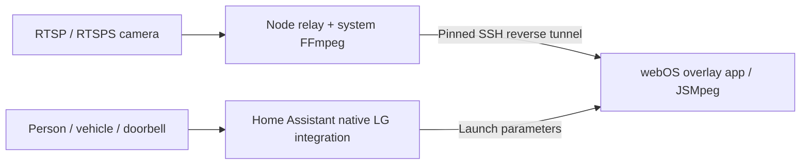

# LG Camera Overlay

Show a live camera panel over what you are watching on an LG webOS TV, including native TV apps and an Apple TV connected through HDMI. Home Assistant chooses when it appears; BACK or a timer dismisses it. Camera audio is disabled so the underlying app keeps its sound.

User-confirmed viewing includes YouTube, Netflix and Plex on the tested LG TVs, plus Plex playing on an Apple TV connected to the OLED65B9PLA through HDMI. See the compatibility details below for the tested combinations.

**[Start here: choose Windows, Mac or Linux Docker](docs/START-HERE.md)** · [Detailed installation reference](docs/INSTALL.md) · [Releases](https://github.com/mbsintegrations/LG-Camera-Overlay/releases) · [Home Assistant setup](docs/HOME-ASSISTANT.md) · [Troubleshooting](docs/TROUBLESHOOTING.md)

The TV app, relay and Home Assistant configuration are three separate installation steps. This uses HA's native **LG webOS TV** integration; no custom HA integration or HACS installation is needed. The relay runs on an always-available computer or locally built Docker container, which can share a Linux/NAS host with Home Assistant. **A packaged HA OS App (formerly add-on) is not included in this release.** See [hosting on HA hardware and hardware recommendations](docs/HOSTING.md) for the available options and their limits.

## What it does

- Continuous video decoded on a canvas, with a 25–55% width panel and 15–90 second duration.
- One encoder per visible camera, shared by multiple TVs. Encoding stops when its last viewer leaves.
- Separate pinned SSH tunnels and reconnects per TV; offline TVs are not woken.
- Optional Developer Mode session checks and renewal, with bounded, credential-free status.
- Reusable HA launch and alert blueprints, configurable camera routing, shared cooldown and doorbell priority.
- Loopback-only relay: no router port forwarding or public camera endpoint.

## Compatibility

The predecessor deployment was physically confirmed on **OLED65B9PLA / SDK 4.10.0** over YouTube and Netflix, and **65NANO766QA / SDK 7.6.0** over Netflix. These are historical observations, not certification of every firmware or this release. See [release validation](docs/VALIDATION.md) for new-build evidence and remaining limits.

On 15 October 2026, the user also confirmed that the overlay works on the **OLED65B9PLA** both with **Plex running directly on the LG** and with **Plex running on an Apple TV connected through HDMI**. The Apple TV requires no overlay app; the LG renders the panel above its HDMI picture. These are confirmations of the working installation; the exact package version was not identified in the viewing report.

The transparent overlay window flag is not a documented LG compatibility contract. Protected video apps, firmware changes and other TV models can behave differently. Disney+ and other HDMI source/app combinations still require their own viewing checks. Developer Mode is required; root is not.

The relay accepts RTSP/RTSPS camera URLs. UniFi Protect is the original tested source. Other cameras depend on the installed FFmpeg build and are not individually certified. There is no cloud relay or video recording feature. Startup consumes part of the chosen display duration; latency varies with camera stream, network, server and TV.

## Project contents

| Path | Purpose |
|---|---|
| `source/` | TV app and pinned MIT-licensed JSMpeg player |
| `relay/` | Portable Node relay and Developer Mode helper |
| `scripts/` | Pairing import, configuration check and IPK build |
| `blueprints/` | HA script and automation blueprints |
| `compose.yaml` | Local Docker build; no published ports |
| `tests/` | Lifecycle, privacy, configuration and encoder checks |
| `tooling/` | Isolated official webOS packager; not a relay dependency |

Own code is **GPL-3.0-only**. Third-party notices remain under their original licences; see [NOTICE](NOTICE) and [licensing](docs/LICENSING.md). LG, webOS, UniFi and Home Assistant are their respective owners' names; this project is independently maintained.
