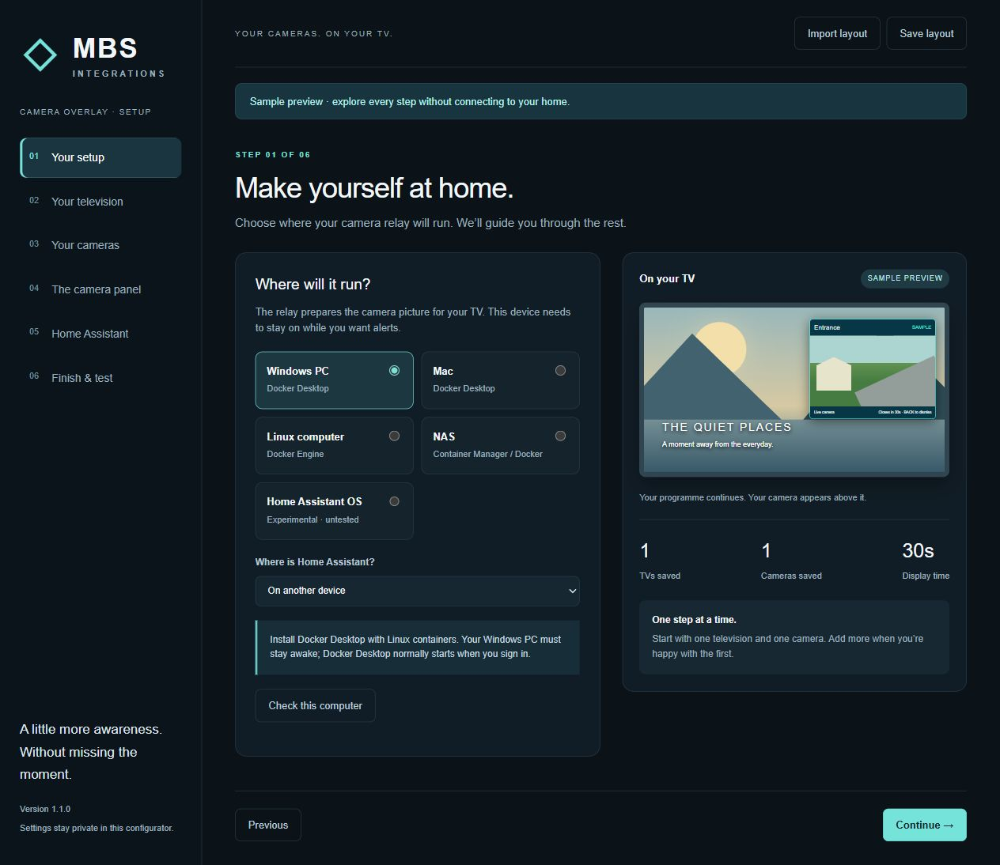
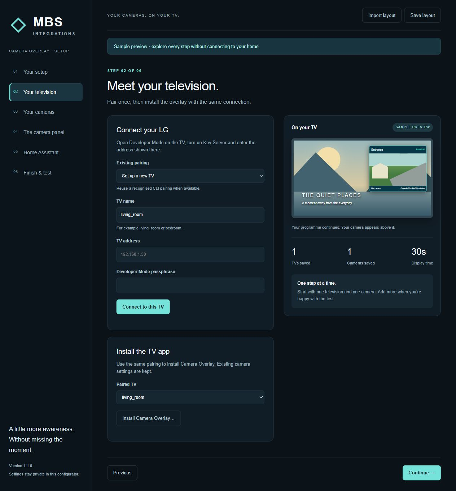
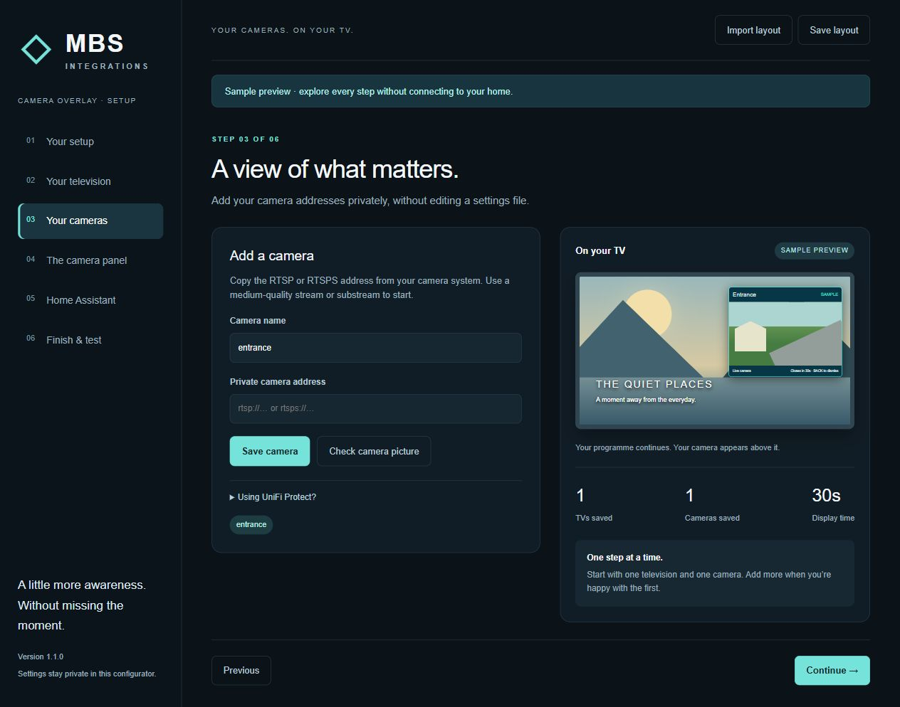
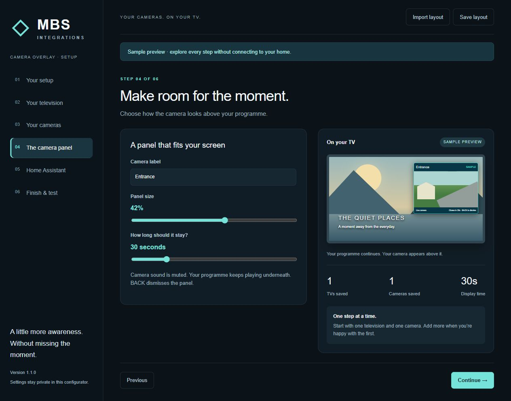
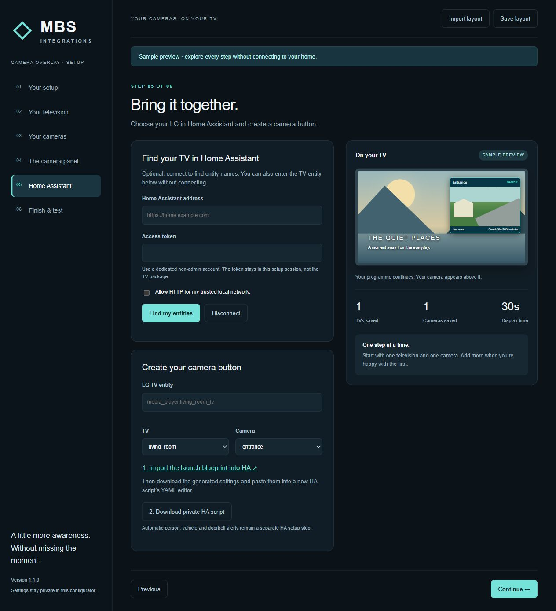
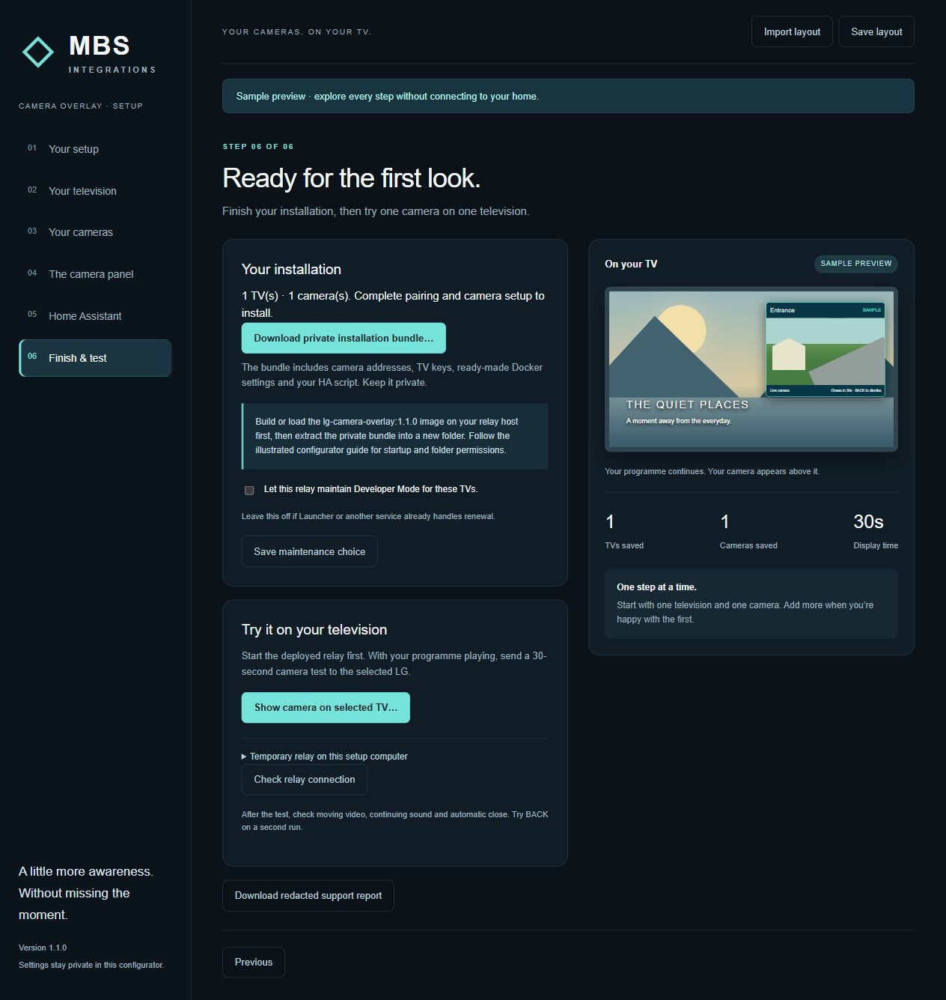

# Install with the configurator

The configurator helps you pair the LG, save camera settings, choose the panel size and generate a Home Assistant script and a private Docker installation bundle. Start with one TV and one camera.

The **TV app** draws the panel. The **relay** is the small background program that brings camera video to the TV. **Home Assistant** tells the TV when to show it. The **configurator** helps you set up these parts; it does not replace Home Assistant.

Have these ready: your LG Developer Mode account and TV address, a camera stream address, your Home Assistant address, and a computer or NAS that can stay on. The six sections below match the six screens in the configurator.

**Tested:** Windows setup checks and screenshots, plus Linux x64 NAS Docker → Home Assistant 2026.10.1 test instance → LG OLED65B9PLA. The user confirmed the panel, continuing picture/sound and automatic close. **HA OS App: experimental and NOT TESTED.** See [test results](VALIDATION.md#configurator-and-nas-docker-acceptance-25-october-2026).

## Before you start: download and open setup

Download **LG-Camera-Overlay-Setup-1.1.0.zip** from [release v1.1.0](https://github.com/mbsintegrations/LG-Camera-Overlay/releases/tag/v1.1.0). Extract the ZIP into a new folder; do not run it from inside the ZIP. This download includes the verified TV package, setup screens, relay source and guides. The TV package remains version 1.0.0; 1.1.0 adds the installer/configurator.

Install **Node.js LTS 22 or newer** from [nodejs.org](https://nodejs.org/en/download). Then:

| Your setup computer | Open setup |
|---|---|
| Windows | Double-click **Start Setup.cmd**. Keep its window open. |
| Mac | Open Terminal in the extracted folder and run `sh "Start Setup.command"`. |
| Linux | Open a terminal in the extracted folder and run `sh "Start Setup.command"`. |

The first launch downloads the locked software dependencies. Open **http://127.0.0.1:8786/** on that same computer. There is no installer account or cloud upload. To explore without using real devices, run `npm run setup:preview` instead; the sample preview cannot save or connect.

The screenshots below show the real configurator in **sample mode**. They illustrate the controls, not a connected customer's credentials or a successful pairing screen.

## 1. Your setup — choose where it will run

The relay computer must stay on whenever you want camera alerts. Your setup computer can be different from your permanent relay host.

| Your situation | Choose | What you need |
|---|---|---|
| Windows PC, HA here in a VM or elsewhere | Windows PC | Docker Desktop using Linux containers; PC awake and Docker running |
| Mac, HA here in a VM or elsewhere | Mac | Docker Desktop for your Mac; Mac awake and Docker running |
| Linux PC, HA here or elsewhere | Linux computer | Docker Engine and Compose |
| Synology or other Docker-capable NAS | NAS | Container Manager/Docker and a private writable runtime folder |
| HA OS installed directly on the hardware | Home Assistant OS | **Experimental, NOT TESTED**; use the separate Docker route for a tested installation |

Select whether Home Assistant is on the same device or another device. Leave your existing HA installation in place: the relay is a separate service. Follow [host preparation](START-HERE.md#1-select-your-situation) if Docker is not installed yet. Windows/macOS Docker Desktop and ARM64 end-to-end TV operation are not validated by the NAS test.



## 2. Your television — pair and install

1. Install LG's **Developer Mode** app on the TV, sign in and enable Dev Mode. Allow its requested restart.
2. Reopen Developer Mode, enable **Key Server**, and keep it open for the initial pairing.
3. In **Your television**, enter a simple name (for example `living_room`), the TV's local IP address and the Developer Mode passphrase. An existing official CLI pairing can also be reused.
4. Click **Connect to this TV**. Check that the address is your TV, then confirm and save its SSH fingerprint. A changed saved fingerprint is rejected rather than silently trusted.
5. Select the paired TV and choose **Install Camera Overlay**. Read and confirm the installation prompt. The bundled IPK checksum is checked first.

This installs or updates the Camera Overlay app on the selected TV. Keep a backup before updating an existing installation. Developer Mode expiry still applies; setup does not root the television or remove LG's privacy services. Read [privacy and network protection](PRIVACY-AND-NETWORK.md).



## 3. Your cameras — add the video stream

In **Your cameras**, give the camera a simple name and paste its full RTSP/RTSPS stream address. Save it. Prefer a medium or low-resolution substream; the output is 768×432. A stream address can contain a password, so keep it private.

**Check camera picture** needs FFmpeg on the setup computer. Docker supplies FFmpeg inside the relay container, but does not install it on your desktop. If this computer only prepares a NAS installation, finish deployment and check video on the TV instead.



## 4. The camera panel — choose its appearance

In **The camera panel**, set the label, width, display time, screen position (any corner or centre), distance from the screen edge (0–10% of screen width), whether to draw a border and its colour, whether to show the frame rate next to LIVE and optional compact mode (title and countdown drawn over the camera picture on a translucent background, so the panel is shorter). The preview updates as you adjust them. It is an illustration, not your live camera. Width is 25–55%; time is 15–90 seconds. The generated Home Assistant script carries these choices; you can change them later in the script's blueprint fields without running setup again.



## 5. Home Assistant — create your camera button

Home Assistant must already have its native **LG webOS TV** integration paired to the TV.

1. Enter your HA address and a long-lived access token from your HA user profile's Security section. Use HTTPS, or explicitly allow HTTP only on your trusted local network.
2. Click **Find my entities**, then select the correct LG media player, saved TV and camera. The token stays in the running setup session and is not written into the TV app or installation bundle.
3. Click the **Import the launch blueprint** link. Then download the generated private HA script.
4. In HA, create a new script, open its YAML editor, paste the downloaded contents and save. JSON-formatted YAML is valid here. Add the script to your dashboard if wanted.

You can disconnect HA or close setup to discard the session token. Revoke a token in HA when no longer needed. Automatic detection alerts are a separate step: follow [UniFi and other detection flows](DETECTION-FLOW.md) and [Home Assistant setup](HOME-ASSISTANT.md).



## 6. Finish & test — install and check the relay

Choose **Download private installation bundle** in **Finish & test**. It contains camera addresses, the relay token, TV pairing keys, `compose.yaml` and your HA script. Keep it outside public shares, Git and cloud-synced folders. Extract it into a **new private runtime folder**, separate from the source download.

### Windows, Mac or Linux Docker

Open a terminal in the extracted **setup/source download** and build the image once:

```sh
docker build -t lg-camera-overlay:1.1.0 .
```

Then open a terminal in the extracted **private installation bundle** and start it:

```sh
docker compose up -d
docker compose logs --tail 50
```

The image is built locally; no prebuilt registry image is supplied. For a different Docker host of the same architecture, `docker save -o camera-overlay-image.tar lg-camera-overlay:1.1.0` and `docker load -i camera-overlay-image.tar` transfer the built image. An Intel/AMD image is not an ARM image.

On Linux/NAS the container runs as **UID 1000**. That user needs read access to the private configuration/keys and write access to `private` and `logs`. On Linux, from the private runtime folder, an administrator can run `sudo chown -R 1000:1000 private logs` and `sudo chmod 700 private logs`. On a NAS, use its supported folder ownership/permission controls or ask its administrator. Do not make these folders publicly readable to fix permission errors.

### Synology Container Manager / other NAS

1. Put the extracted setup source in a folder such as `docker/lg-camera-overlay-source`.
2. Put the extracted private bundle in a separate folder such as `docker/lg-camera-overlay-runtime`, with the permissions above.
3. To build on the NAS, add these two lines under `camera-overlay:` in the bundle's `compose.yaml`, at the same indentation level as `image:`:

   ```yaml
       build:
         context: ../lg-camera-overlay-source
   ```

4. In Container Manager → **Project → Create**, choose a project name and the private runtime folder; use its existing Compose file. Build/start that project. Leave Web Station/web portal exposure disabled. Other NAS tools offer the equivalent Compose project workflow.
5. Inspect its log for `relay_ready` and `tv_tunnel_ready` for the on-screen TV. No published relay port, public URL or router forwarding is needed.

If setup runs inside Docker alongside HA Container, use HA's reachable address. In our NAS test, the host's published HA port was unreachable from another Docker bridge; attaching the review container to **only the HA test network** and using HA's container name resolved it. Keep the host setup UI local: the optional setup image must publish only `127.0.0.1:8786:8786` and use an SSH forward for remote access. The simpler route is to run the configurator on your desktop and export the NAS bundle.

### Watch the test before enabling alerts

Turn on the TV, start a programme and be in the room watching it. Start the deployed relay first, then choose **Show camera on selected TV** and confirm. It does not wake an unavailable/off TV. Check moving camera video, continuing programme picture/sound, automatic close and BACK on a second run.

The relay status button checks the relay **on the setup host**. It cannot report a separate NAS relay's health from your desktop; use the NAS logs and the TV viewing test for that deployment. The optional **temporary relay** is also local to the setup computer and stops when setup closes; it is not a permanent service installer.

Leave Developer Mode maintenance off if Launcher or another service already renews the same TVs. If this relay owns renewal, enable it and save before deploying; restarting the managed relay applies saved changes.



To stop the permanent Docker relay, run `docker compose down` in its runtime folder. Its private settings remain on disk. Stopping the relay does not uninstall the TV app or remove your HA script.

## HA OS App: experimental and NOT TESTED

**The HA OS/Supervisor App has not been tested. The successful NAS Docker test does not validate ingress, App installation, updates or restart behaviour.** The separately named experimental ZIP is for a disposable HA OS test system only, not the recommended installation route.

For developers testing it: extract `lg_camera_overlay/` into that test system's local `/addons`, refresh local Apps, install it, start and open its web UI. No public one-click App repository is provided. It requests admin-only ingress and no host ports, host networking or HA/Supervisor API access. It prepares its own `/data` storage before dropping to the `node` user. Manifest architectures `amd64`/`aarch64` are packaging declarations, not proof of platform acceptance.
