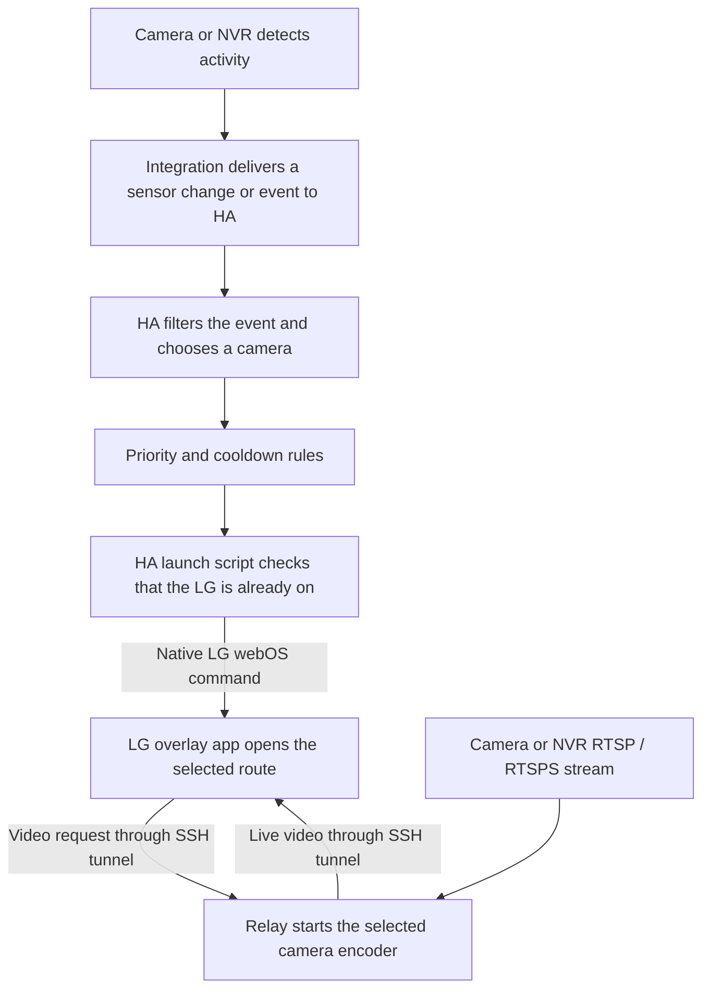

# How a detection becomes a TV overlay

The project needs two separate inputs: **a video stream to show** and, for automatic alerts, **a signal telling Home Assistant when to show it**. RTSP/RTSPS supplies the video. It does not, by itself, give this project person detection, zones or doorbell events. A manual HA button can show a camera without any detection integration.

This guide describes a UniFi detection flow and how other systems can supply equivalent signals. See [tested and operating setups](VALIDATION.md#tested-and-operating-setups) for the evidence and limits.

## Follow the two paths

1. The camera, NVR or a separate detector decides that something happened. Zone and object recognition belong to that system, unless you explicitly build additional HA filtering.
2. Its HA integration or other configured connection delivers a trigger. This can be a binary sensor changing from `off` to `on`, a doorbell event or another supported HA automation trigger.
3. Your HA automation decides which camera to show, applies cooldown/priority rules and calls the chosen launch script. A trigger does not automatically know which stream you want: you configure that mapping.
4. The launch script checks the LG's state and sends a launch command using HA's native LG webOS integration. It supplies the selected private relay route, camera label, size and display duration. It targets the LG even when you are watching Apple TV through HDMI.
5. The overlay app requests that route over the existing SSH tunnel. Only then does the relay start reading/converting that camera stream. HA does not forward the video or perform object recognition for this project.
6. BACK or the display timer closes the panel. When the final viewer leaves a camera, its encoder stops. Multiple TVs can share an encoder for the same camera.

The detector may continue analysing video independently while no TV overlay is open. Its processing, hardware needs and recording policy are separate from this relay.

## How the existing UniFi installation uses it

The operating reference installation uses UniFi Protect camera streams and detection entities, Home Assistant's native UniFi Protect and LG webOS integrations, a native Node/FFmpeg relay on an Apple Silicon Mac mini, and two LG TVs. It predates the portable public release and uses household-specific scripts; it is not evidence that every public-package deployment has been physically tested.

| Source in the reference installation | Signal selected in HA | Camera shown | Treatment |
|---|---|---|---|
| Front Left camera | Person **or** vehicle binary sensor changes `off` → `on` | Front Left medium stream | Normal alert |
| Front Right camera | Person binary sensor changes `off` → `on` | Front Right medium stream | Normal alert |
| Entry doorbell | Actual doorbell `ring` event | Entry medium stream | Priority alert |

The first accepted normal alert displays for **30 seconds** and starts a **60-second shared cooldown**. Further normal detections during that cooldown are suppressed. A doorbell ring can replace the current panel and restart the cooldown. Each already-on TV receives the selected camera; sleeping/off TVs are not woken. The dashboard Pause control disables automatic camera alerts while manual launch scripts remain usable.

These are reference choices, not mandatory camera names, IDs or timings. Our saved reference automation checks for at least one active TV before starting its cooldown. The public blueprint starts its timer before calling launch actions; its launch scripts still skip off TVs, but an event with every TV off can consume a cooldown interval. The public coordinator uses queued execution, so priority bypasses the cooldown when processed; keep launch actions short rather than adding long waits.

### What the UniFi zones do, and what HA actually checks

Detection zones were configured in Protect. The saved overlay automation listens to **camera-level person/vehicle binary sensors**; it does not read a polygon, match a named zone or inspect a zone ID. It trusts the selected detection signal that reaches HA.

Therefore, do not assume that a zone used to filter Protect phone notifications also filters the sensor used by HA. Detection settings, notification rules and the metadata exposed by an integration are different things. Check your actual camera/Protect/HA combination. Current [HA UniFi Protect documentation](https://www.home-assistant.io/integrations/unifiprotect/) describes both object sensors and event entities; exposed features depend on software, camera capabilities and connection permissions.

If you need **only a particular zone**, use a signal already limited to that zone, or an event exposing enough zone information for HA to filter it. Verify the actual event data first. A camera-level `on/off` sensor without zone metadata cannot tell this automation which zone caused it. This project does not add zone recognition to that sensor.

### Set up your own UniFi triggers

1. Configure the camera's desired smart detection types and zones in Protect. Enable a suitable RTSP/RTSPS stream separately. Do not assume an enabled stream also enables detections.
2. Add **UniFi Protect** through HA Settings → Devices & services, using the [official integration setup](https://www.home-assistant.io/integrations/unifiprotect/). If it is already working, reuse it. Follow the requirements for your installed versions and verify that your connection exposes the required detection and ring entities.
3. Open the camera's HA device page and identify its actual person/vehicle entities. For a doorbell, inspect its ring event or supported ring sensor. Do not copy the entity names from somebody else's house.
4. In HA's state/event tools, observe one detection and its reset. Note exactly which entity changes or which event type arrives. A generic motion sensor can include activity that a person-only sensor would exclude.
5. Prove a manual overlay works using the [installation guide](START-HERE.md). Create one launch script for each desired camera/TV combination.
6. Follow [automatic alert setup](HOME-ASSISTANT.md#add-optional-automatic-alerts). For binary sensors use `off` → `on`. Assign a normal trigger ID such as `front_left`; use a Choose action with a **Trigger** condition for that ID to select its launch script. Two triggers can share an ID if both should select the same camera.
7. Put doorbell triggers in the priority input and set their trigger ID to exactly `priority`. Select the entry-camera launch script in priority actions. This ID is required by the public blueprint, even though the older household automation used its own names.
8. Start with 30-second displays and a dedicated 60-second timer. Verify the walkthrough below before relying on real alerts.

Use the native trigger offered by your installed integration where appropriate. A momentary event is not necessarily an `off` → `on` binary sensor: choose the right trigger type and filter its actual event type. State restoration after an outage is not a new physical detection.

## How other camera systems could work

The relay is not tied to UniFi. It needs a reachable RTSP/RTSPS URL that the installed FFmpeg can decode, with working authentication. Automatic alerts separately need a usable HA trigger. **The alternatives below are integration approaches, not tested compatibility claims for this project.**

| Possible source | What must reach HA | What you configure | Project evidence |
|---|---|---|---|
| Another camera/NVR's HA integration | Person/vehicle/motion sensor or a supported event | Match the actual entity/event to a camera launch script | Not physically validated here |
| Frigate | Detection/occupancy entities or suitably filtered events through its HA/MQTT setup | Select camera, object and zone as required; map the accepted signal to a launch script | Not validated here; follow [Frigate's HA integration guide](https://docs.frigate.video/integrations/home-assistant/) |
| MQTT-capable detector/NVR | A broker message HA can receive, or a configured MQTT binary sensor | Define topic/payload meaning, filter the desired event and map it to a script | Not validated here; follow [HA MQTT setup](https://www.home-assistant.io/integrations/mqtt/) |
| System with webhooks only | A configured HA webhook trigger with enough information to select/filter the alert | Validate expected payload fields and map only recognized values to predefined scripts | Not validated here; requires separate setup |
| Separate PIR, door/contact sensor or doorbell button | Its existing HA state change or event | Choose a fixed camera to show for that sensor | Possible even if the camera has no detection features; not validated here |
| RTSP-only camera, no detector | Nothing automatic arrives from this relay | Use a manual HA button, or add one of the detection sources above | Video compatibility still needs testing |

The camera supplying video and the device triggering it do not have to be the same device or brand. For example, a door contact could request the entrance camera without that camera detecting anything itself. The project does not automatically install Frigate, MQTT, ONVIF event handling or vendor integrations.

### Minimum information HA needs

For a fixed mapping, a reliable **“trigger happened”** signal is enough: you choose the stream in the launch action. To make more selective rules, HA also needs the relevant distinctions:

| Desired rule | Required information or pre-filtered signal |
|---|---|
| Show one camera when a sensor activates | Known sensor/event mapped to that camera |
| Person only, not all motion | Person-specific signal or an event object-type field HA can filter |
| Only the driveway zone | Zone-specific signal or verified zone metadata |
| Route several cameras from one event feed | A stable source/camera identifier mapped to known launch scripts |
| Doorbell overrides ordinary detections | A distinguishable ring event mapped to the blueprint's `priority` trigger |
| Suppress repeated updates for one detection | Event identity/lifecycle information, or upstream deduplication, plus the configured cooldown |

The relay does **not** define a standard detection JSON payload or receive these notifications itself. Messages go through a configured HA integration/trigger. For example, a vendor might send `camera=driveway`, `object=person`, `zone=entrance`, `phase=start` and an event ID; those names are illustrative, not an API this project provides. Inspect the real payload and configure HA accordingly. Never copy a vendor payload directly into a launch URL; map allowed values to your own predefined camera scripts.

For MQTT, ensure old retained messages or reconnects do not masquerade as new detections. For event streams, distinguish new detections from updates/end events. For binary sensors, use an appropriate activation transition and confirm reset behaviour. For webhooks, follow HA's local-access/security guidance and keep webhook IDs secret. See [HA automation trigger documentation](https://www.home-assistant.io/docs/automation/trigger/) for the supported trigger types.

## Verify the complete flow

Begin with manual launches and inert test notifications/counters where possible. Test one stage at a time so a failed video stream is not mistaken for a zone problem.

| Test | What to observe |
|---|---|
| Manual launch | Selected camera appears, moving video, underlying programme/audio remain usable, BACK and timeout close it |
| Desired detection inside the zone | Detector records it; HA receives the intended signal; automation trace selects the expected camera |
| Activity outside the desired zone | No accepted overlay trigger; inspect the HA signal even if the detector's phone app stays silent |
| Different object type | Person-only rules reject unwanted types; repeat with a vehicle if vehicle alerts are wanted |
| Repeat during cooldown | No second normal overlay; priority ring still selects its configured camera |
| Another normal detection after cooldown | Expected camera launches again |
| Pause, then resume | Automatic triggers stop and resume; manual scripts remain usable |
| TV off or source unavailable | No TV wake; failures stay isolated and later valid tests recover |

For a priority test, use the actual supported doorbell event or a controlled test trigger; do not operate locks or gates. Complete physical zone tests safely without creating road hazards. Check sensor state/event data and the automation trace alongside what appears on screen. Our historical person-walk and doorbell tests do not prove every zone boundary, road-traffic exclusion or vehicle case. Record your own results with camera/NVR, HA, TV and relay versions.

## Where to look when it fails

- **No detection in the camera/NVR:** check its detector, object types and zones.
- **Detection there, nothing in HA:** check the integration/transport, entity availability and permissions.
- **HA receives it, automation does not run:** check trigger type, state transition, filters and whether alerts are paused.
- **Automation runs but skips launch:** inspect its trace for cooldown, priority ID, camera mapping and TV state.
- **Launch succeeds but no video:** check the relay's tunnel, private route, stream access and FFmpeg; see [troubleshooting](TROUBLESHOOTING.md).

Keep camera credentials, tokens and raw private event data out of public support reports. For evidence of what is actually operating or tested by the maintainer, use the [validation matrix](VALIDATION.md#tested-and-operating-setups), not the list of possible integrations above.
